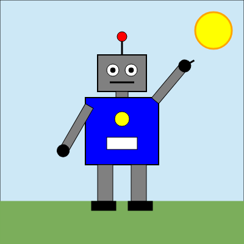

# Linguagem — Fases 1 e 2 (léxico, sintático, AST, semântica e SVG)

Linguagem de comandos para descrever desenhos. Na Fase 1 fizemos o léxico, o sintático e a AST. Na Fase 2 completamos o compilador com a verificação semântica e o gerador de SVG:

```text
programa → tokens → AST → verificação semântica → SVG
```

**Testar online:** https://vitorlocateli.github.io/Analisador/

## Integrantes

| Nome completo | RA |
|---|---|
| Vitor Utimura Locateli | 23024638 |
| Lara Marina de Oliveira | 23024708 |

## Arquivos

A página é a página-base da disciplina. `index.html`, `main.js`, `svg.js` e `lexer.js` vieram prontos.

| Arquivo | Para que serve |
|---|---|
| `index.html` | página: entrada, mensagens, tokens, AST, SVG gerado e imagem |
| `main.js` | liga a página aos módulos (pronto) |
| `svg.js` | valida, desenha e baixa o SVG (pronto) |
| `lexer.js` | analisador léxico (pronto) |
| `tokens.js` | lista de tokens (expressões regulares) |
| `parser.js` | analisador sintático descendente recursivo, gera a AST (na Fase 2 os nós guardam a linha) |
| `semantica.js` | **Fase 2:** verificações semânticas (tela, círculo e retângulo com zero) |
| `gerador.js` | **Fase 2:** gera o SVG a partir da AST |
| `casos.js` | os 10 casos de teste com o resultado esperado (usado pelo `testes.mjs`) |
| `casos-de-teste.md` | os mesmos casos, legíveis, com a saída esperada completa |
| `testes.mjs` | confere os casos automaticamente: `node testes.mjs` |
| `testes/` | `.svg` e imagem dos 5 programas válidos, e print da página nos 2 erros semânticos |
| `desenho-final/` | o desenho final: programa (`robo.txt`), `robo.svg` e imagens |

## Como rodar

Os navegadores não carregam módulos (`type="module"`) abrindo o arquivo com duplo clique. Use o link do GitHub Pages acima ou um servidor local:

- **VS Code:** extensão Live Server → botão direito no `index.html` → *Open with Live Server*.
- **Terminal:** na pasta do projeto, `python -m http.server 8000` e abra `http://localhost:8000`.

## Como testar

1. Abra a página.
2. Escreva um programa na caixa **Entrada** (ou copie um de `casos-de-teste.md` ou o `desenho-final/robo.txt`).
3. Clique em **Analisar**.
4. Programa certo: o SVG aparece na coluna da direita e já vem desenhado. Dá para baixar com **Baixar .svg**.
   Programa com erro: aparece a mensagem de erro léxico, sintático ou semântico, com a linha.

Para conferir os 10 casos de uma vez pelo terminal: `node testes.mjs`.

## Desenho final

Um robô dando tchau. Usa reta, círculo e retângulo, e grupos aninhados com `mover` e `girar` (o braço direito é um grupo dentro do robô, e a mão é um grupo dentro do braço).



## Exemplo

```
tela 400 300
% um carro simples
retangulo 50 150 200 60 fundo=azul
grupo mover 70 190 {
    circulo 0 0 25 fundo=preto
    grupo girar 45 {
        reta 0 0 20 0 borda=branco espessura=2
    }
}
grupo mover 200 190 {
    circulo 0 0 25 fundo=preto
}
```
